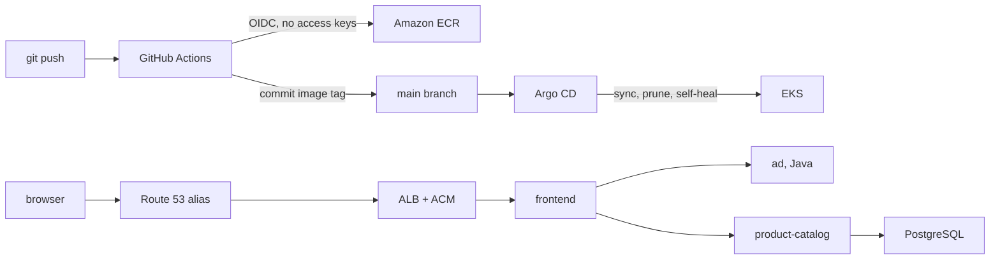
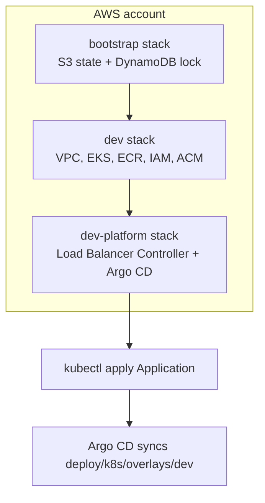

# End-to-End GitOps Microservices Pipeline

A small AWS EKS environment that builds the OpenTelemetry Astronomy Shop **ad**
service, pushes the image to Amazon ECR, and lets Argo CD deploy it.

The shop itself is the upstream [OpenTelemetry demo](https://github.com/open-telemetry/opentelemetry-demo)
(Apache License 2.0). This repository adds the delivery path around a subset of
that demo: Terraform, GitHub Actions, Argo CD, and an AWS load balancer. The
original demo README is kept at [docs/UPSTREAM_README.md](docs/UPSTREAM_README.md).

The ad service's business logic is upstream Java. The image build, the registry,
the cluster, and the path from a commit to a running pod are what this project owns.

## Architecture



Terraform is the thing that creates the account resources. It does not deploy
the shop. Argo CD does, from the manifests in `deploy/k8s`.



## What runs on the cluster

The full Astronomy Shop needs Kafka, OpenSearch, Jaeger, Grafana, and a handful
of other services. That does not fit a two-node `t3.medium` cluster, and most of
it is not needed to show the delivery path. This slice is the storefront plus
the services it calls for browsing and the cart:

| Workload | Image | Why it is here |
| --- | --- | --- |
| ad | **this repo, via ECR** | The Java service the pipeline builds |
| frontend | `ghcr.io/open-telemetry/demo:2.2.0-frontend` | The shop UI, behind the load balancer |
| product-catalog | upstream `2.2.0` | Product list. Needs PostgreSQL |
| postgresql | `postgres:17.8` | Catalog database. Schema from `src/postgresql/init.sql` |
| currency | upstream `2.2.0` | Price conversion |
| recommendation | upstream `2.2.0` | Product-page recommendations |
| cart + valkey | upstream cart `2.2.0`, Valkey | Cart icon and add-to-cart |
| flagd | `ghcr.io/open-feature/flagd:v0.13.3` | Feature flags the ad service reads |
| otel-collector | `otel/opentelemetry-collector:0.145.0` | OTLP endpoint. It logs telemetry and does not store it |

Checkout, payment, shipping, email, Kafka, and the observability UIs are not
deployed. The cart page can load. Checkout will fail, because those services
are absent on purpose.

Upstream images stay on the `2.2.0` release tags. Only `ad` is rebuilt from
this repository, because that is the service the pipeline is here to deliver.

## Repository layout

```text
infra/bootstrap/          S3 remote state and DynamoDB lock. Local backend.
infra/modules/vpc/        Public and private subnets, one NAT gateway.
infra/modules/eks/        Cluster, managed node group, cluster OIDC provider.
infra/modules/ecr/        Immutable repository for the ad image.
infra/modules/iam/        GitHub OIDC, CI role, plan role, IRSA for the load balancer.
infra/modules/dns/        ACM certificate and the Route 53 alias.
infra/envs/dev/           Wires those modules together.
infra/envs/dev-platform/  Helm releases that need a running API server.
deploy/k8s/base/          Workload manifests.
deploy/k8s/overlays/dev/  ECR image name, tag, and the ingress.
deploy/argocd/            Argo CD Helm values and the Application.
src/ad/                   Upstream ad service. The Dockerfile is the multi-stage build.
.github/workflows/        ad-service.yml and terraform.yml.
scripts/validate.sh       Checks that do not need AWS.
```

The upstream demo under `src/` is otherwise unchanged, apart from a unit test
and test dependencies on the ad service so the CI job has something real to run.

## Cost

Leave this running and the bill is dominated by things that charge by the hour
even when nobody is looking. In ap-southeast-2 the rough shape is:

- EKS control plane, about USD 0.10 an hour
- one NAT gateway, about USD 0.045 an hour, plus data and a public IPv4 address
- two `t3.medium` workers
- one Application Load Balancer, about USD 0.0225 an hour plus LCUs

Together that is on the order of **USD 200 a month**. ECR, the state bucket,
and the lock table are small next to that. Check the AWS pricing calculator
for current numbers before you apply, and destroy the stacks when you are done.
The [teardown](#teardown) order matters: an orphaned load balancer keeps billing
after the cluster is gone.

## Prerequisites

- AWS CLI v2, Terraform `>= 1.6`, kubectl, and kustomize on your machine
- Docker, if you want to push the first ad image yourself
- An IAM principal that can create VPC, EKS, ECR, IAM, S3, DynamoDB, ACM, and Route 53 records
- A domain whose Route 53 hosted zone **already exists** in this account. This project does not register a domain and does not create the zone
- This Git repository reachable by Argo CD. A public repository needs no credentials. A private one needs a repository secret in Argo CD before the Application can sync

## Deploy

Commands assume the repository root. Replace account id, zone id, and hostname
with your own.

### 1. Bootstrap remote state

```bash
cd infra/bootstrap
terraform init
terraform apply -var region=ap-southeast-2 -var state_bucket_name=otel-gitops-ACCOUNT_ID-tfstate
```

Note the bucket name and the lock table name from the outputs.

### 2. Configure the dev backend

```bash
cd infra/envs/dev
cp backend.hcl.example backend.hcl
cp terraform.tfvars.example terraform.tfvars
```

Edit `backend.hcl` with the bucket and table from step 1. Edit `terraform.tfvars`:

- `state_bucket_name` and `lock_table_name` from step 1
- `hosted_zone_id` of the zone you already have
- `app_hostname`, a name inside that zone, such as `shop.example.com`
- `github_owner` and `github_repo` if the repository is not `jjyy032659/Opentelemetry`
- `create_github_oidc_provider = false` if this account already has a GitHub OIDC provider. AWS allows one provider per URL. A second one fails with `EntityAlreadyExists`

Leave `alb_dns_name` and `alb_zone_id` empty.

`backend.hcl` and `terraform.tfvars` are gitignored. Do not commit them.

### 3. Apply the dev stack

```bash
cd infra/envs/dev
terraform init -backend-config=backend.hcl
terraform apply
```

This creates the VPC, the EKS cluster, the managed node group, ECR, the CI
roles, and the ACM certificate. The certificate stays pending until the
validation records are visible to public DNS. `terraform apply` waits for that.
If it times out, check that the hosted zone is the one the domain's registrar
delegates to, then apply again.

Confirm the Kubernetes version is still offered before you rely on the default:

```bash
aws eks describe-addon-versions --addon-name vpc-cni \
  --query 'addons[0].addonVersions[].compatibilities[].clusterVersion' --output text
```

Write a kubeconfig entry:

```bash
eval "$(terraform output -raw configure_kubectl)"
kubectl get nodes
```

### 4. Publish the first ad image

ECR tags are immutable. The overlay starts at tag `bootstrap`. Push that tag
once so the pod can start before GitHub Actions has run:

```bash
ECR_URL="$(terraform -chdir=infra/envs/dev output -raw ecr_repository_url)"
AWS_REGION="$(terraform -chdir=infra/envs/dev output -raw region)"
aws ecr get-login-password --region "$AWS_REGION" \
  | docker login --username AWS --password-stdin "${ECR_URL%%/*}"
docker build -f src/ad/Dockerfile -t "$ECR_URL:bootstrap" .
docker push "$ECR_URL:bootstrap"
```

### 5. Point the overlay at your account

```bash
python3 scripts/configure-dev-overlay.py
git add deploy/k8s/overlays/dev
git commit -m "chore: set dev ingress and ad image"
git push
```

The script reads the dev outputs and writes the certificate ARN, the hostname,
and the ECR repository into the overlay. Later CI commits replace the image tag
and leave the ingress alone.

### 6. Install the load balancer controller and Argo CD

```bash
cd infra/envs/dev-platform
cp backend.hcl.example backend.hcl
cp terraform.tfvars.example terraform.tfvars
```

Set `state_bucket` to the same bucket as step 1. Then:

```bash
terraform init -backend-config=backend.hcl
terraform apply
```

The AWS CLI on this machine is what `aws eks get-token` uses. Use the same
principal that created the cluster.

### 7. Register the Application

```bash
kubectl apply -f deploy/argocd/application.yaml
kubectl -n argocd get applications
```

Argo CD polls `main` at `deploy/k8s/overlays/dev`, syncs it, prunes removed
objects, and puts drifted objects back. The repository URL in that file must
match your GitHub repository.

The UI is not on the internet. The server is HTTP inside the cluster because
`server.insecure` is set:

```bash
kubectl -n argocd get secret argocd-initial-admin-secret \
  -o jsonpath='{.data.password}' | base64 -d; echo
kubectl -n argocd port-forward svc/argocd-server 8080:80
```

Open `http://localhost:8080` and sign in as `admin`. Delete the initial secret
after you have changed the password.

### 8. Create the Route 53 alias

Wait until the ingress has an address:

```bash
kubectl -n otel-demo get ingress frontend
```

Copy the hostname into `alb_dns_name`. The load balancer's own hosted zone id
is not your domain's zone. It is on the ingress annotation
`alb.ingress.kubernetes.io/load-balancer-hosted-zone-id` (or in the EC2 console
on the load balancer). Put that in `alb_zone_id`.

```bash
cd infra/envs/dev
terraform apply
```

Open `https://<app_hostname>`. The certificate is the one Terraform requested.

### 9. Let CI take over the ad image

In the GitHub repository settings, add **Actions variables** (these are not
secrets; the role ARN is not a password):

| Variable | Value |
| --- | --- |
| `AWS_ROLE_ARN` | output `ad_ci_role_arn` |
| `AWS_REGION` | for example `ap-southeast-2` |
| `ECR_REPOSITORY` | `otel-demo-ad` |
| `AWS_TERRAFORM_ROLE_ARN` | output `terraform_plan_role_arn` |
| `TF_STATE_BUCKET` | state bucket name |
| `TF_LOCK_TABLE` | lock table name |
| `TF_VAR_HOSTED_ZONE_ID` | your hosted zone id |
| `TF_VAR_APP_HOSTNAME` | your hostname |
| `TF_VAR_CREATE_GITHUB_OIDC_PROVIDER` | `true` or `false`, matching the tfvar |

The trust policy only allows `refs/heads/main` to push an image, and allows
`pull_request` plus `main` to plan. A pull request build of the ad service
compiles, tests, and builds the image. It does not push. A push to `main` that
touches `src/ad`, `pb`, or the workflow pushes `:<git sha>` and commits the
tag into `deploy/k8s/overlays/dev/kustomization.yaml`. Argo CD syncs that commit.

The plan workflow does not apply. Apply stays on your machine. Plan runs on a
pull request only after the variables above are set. Until then it still formats,
lints, and validates.

If branch protection blocks the bot from pushing to `main`, allow
`github-actions[bot]` to push, or the tag commit never lands and Argo CD keeps
the previous image.

## Teardown

Do this in order. Deleting the cluster first leaves the load balancer behind,
and that load balancer keeps costing money.

```bash
# 1. Ask the controller to delete the load balancer while the cluster still exists.
kubectl -n argocd delete application otel-demo
kubectl -n otel-demo delete ingress frontend
# Wait until the ALB is gone in the EC2 console. This often takes a few minutes.

# 2. Remove the charts.
cd infra/envs/dev-platform
terraform destroy

# 3. Remove the cluster, VPC, NAT, ECR, roles, and certificate.
cd infra/envs/dev
terraform destroy

# 4. Empty the state bucket (including old versions), then remove it.
cd infra/bootstrap
terraform destroy
```

EKS sometimes leaves elastic network interfaces behind for a few minutes.
If `terraform destroy` in the dev stack fails on the VPC, wait and run it again.

To destroy the state bucket while it still has objects, set `force_destroy = true`
on the bootstrap stack, apply, then destroy. Do that only when you mean to
delete the state.

## Design decisions

**Two Terraform states, plus a local bootstrap.** The Helm provider connects to
the API server during plan. That server does not exist the first time you plan
the cluster. The platform stack is separate so a chart change does not refresh
the VPC, and so `terraform validate` on the cluster does not need Kubernetes.
Bootstrap stays on a local backend because the S3 bucket cannot store its own
state until it exists.

**DynamoDB lock, not the newer S3 lock file.** Terraform can lock with an S3
object alone. This project uses a DynamoDB table with hash key `LockID` because
that is the locking design the stack is here to show, and because the table is
obvious when you read the backend block. The key name is fixed by the S3 backend.
It is not a name you get to choose.

**One NAT gateway.** Worker nodes are in private subnets, so image pulls go out
through NAT. One NAT is a single point of failure for outbound traffic and it
is cheaper than one per AZ. A production VPC would use one NAT per AZ, or VPC
endpoints for ECR and S3 if the goal was to drop the NAT cost.

**Managed node group, not self-managed nodes.** The EC2 instances are real
workers. EKS owns the Auto Scaling group and the node AMI. There is no bastion.
`kubectl` uses the public API endpoint, and the nodes use the private endpoint.
`cluster_endpoint_public_access_cidrs` should be your own IP if the cluster
will stay up.

**The creator of the cluster is the admin.** `bootstrap_cluster_creator_admin_permissions`
records that principal as a cluster admin. Extra admins go in
`additional_admin_principal_arns`. Use a role ARN or a user ARN, not an
assumed-role session ARN (`...:assumed-role/.../session`). Session ARNs are
rejected by the access entry API.

**GitHub OIDC instead of access keys.** The workflows call
`sts:AssumeRoleWithWebIdentity`. Nothing in GitHub is an `AKIA` key. The image
role trusts only `repo:<owner>/<repo>:ref:refs/heads/main`. The plan role also
trusts `pull_request`, which is the subject GitHub sends for a pull request in
this repository. Fork pull requests do not get that subject for this workflow.
The account can have only one IAM OIDC provider for
`token.actions.githubusercontent.com`. Set `create_github_oidc_provider` to
false when another project already created it.

**IRSA for the load balancer, not the node role.** The node role can pull from
ECR and attach network interfaces. It cannot create load balancers. The
controller's service account assumes its own role. The trust policy names
`system:serviceaccount:kube-system:aws-load-balancer-controller`, so another
pod cannot assume it. The policy JSON is the upstream controller policy, vendored
at `infra/modules/iam/policies/` so apply does not download it and so you can
read it.

**Immutable ECR tags.** A git SHA cannot be overwritten. The workflow checks
`describe-images` and skips the push when that tag exists, so a re-run of the
same commit does not fail. The deployment uses `imagePullPolicy: IfNotPresent`,
which is safe only because the tag cannot move.

**The Route 53 alias is a second apply.** Terraform cannot know the load
balancer hostname until Kubernetes has created it. The certificate and its
validation records are created on the first apply. `alb_dns_name` stays empty,
and the alias resource uses `count` so it is absent until you know the name.
external-dns would create the alias from inside the cluster. This project keeps
the record in Terraform so there is one place that owns DNS.

**The flag file and the SQL schema are not copied into `deploy/`.** Kustomize
refuses to read a file outside its own directory unless you pass
`--load-restrictor LoadRestrictionsNone`. Argo CD is given that flag in
`deploy/argocd/values.yaml`, and `scripts/validate.sh` passes it too. The files
stay next to the demo so there is one copy to edit.

**Argo CD prunes and self-heals.** `prune: true` deletes objects you removed
from git. `selfHeal: true` reverts a manual `kubectl edit`. A bad image is
reverted by reverting the tag commit, not by editing the cluster. The
Application is applied once with kubectl. Terraform installs Argo CD and stops
there, because planning a custom resource requires the CRD to already exist.

**The collector is a sink.** Services export OTLP to it, and it logs the data
with the debug exporter. Adding Jaeger or a managed backend is a later decision
and would not fit these nodes. Browser traces are not exported: that would mean
putting the collector on the internet.

**PostgreSQL uses an emptyDir.** The catalog data is recreated from `init.sql`
whenever the pod is rescheduled. There is no EBS volume and no EBS CSI driver
to explain. That is the right trade for a demo and the wrong trade for data
you meant to keep.

## Local checks

No AWS account is required for:

```bash
bash scripts/validate.sh
```

That runs `terraform fmt`, `terraform init -backend=false`, `terraform validate`
for all three stacks, tflint, `kustomize build` piped to kubeconform, and
actionlint. Building the ad image is separate:

```bash
docker build -f src/ad/Dockerfile -t otel-demo-ad:local .
```

From `src/ad`, `./gradlew test` runs the unit tests. It needs JDK 21 and network
access the first time, because Gradle downloads the wrapper and the dependencies.

## Interview notes

Be precise about what is upstream. The Astronomy Shop is a CNCF demo. You can
walk through its ad service, and you should say that the service code came with
the demo. What you operated is the pipeline below.

**What is GitOps here?** The cluster's desired state is the YAML in git. CI
does not run `kubectl apply`. CI pushes an image and commits the tag. Argo CD
notices the commit and syncs. If someone deletes a Deployment by hand,
self-heal puts it back. If you delete a manifest from git, prune deletes the
object.

**Why is the image tag a commit, not `latest`?** `latest` does not tell you
what is running, and with `IfNotPresent` a node can keep an old copy. A git SHA
on an immutable tag answers "what is in production?" by looking at the overlay.

**What happens when a deploy is bad?** Revert the commit that changed the tag
and push. Argo CD syncs the previous SHA. You do not SSH to a node. ECR still
has the previous image because the lifecycle rule keeps 20 tags.

**Why OIDC and not a stored key?** A stored key is a long-lived secret in
GitHub. Anyone who copies it acts as that IAM user until you rotate it. OIDC
gives Actions a short-lived token whose subject is the repository and the
branch. The role's trust policy rejects every other subject. There is no key
to leak.

**Why can the plan role read `*` on `ec2:Describe*`?** Most describe and list
actions do not support resource-level permissions. The alternative is to omit
them and have `terraform plan` fail. The role still cannot create, modify, or
delete those resources. The lock table is the only place it can write, and it
has to, because plan takes a lock.

**What does the state lock stop?** Two applies at once would both read the same
state, both change the VPC, and one would overwrite the other's state. The
DynamoDB item is the lock. The second apply waits or fails instead of corrupting
state. Versioning on the bucket is the recovery path if a state write is bad.

**Walk the network.** `10.0.0.0/16`. Two public `/24`s with a route to the
internet gateway. Two private `/24`s with a route to one NAT. Nodes have no
public IP. The load balancer is created in the public subnets because they are
tagged `kubernetes.io/role/elb=1`. The controller finds them by that tag. Pods
use VPC CNI, so the ingress uses `target-type: ip` and the load balancer
registers pod IPs directly.

**What is IRSA in one sentence?** The pod's service account is annotated with
a role ARN, the cluster's OIDC provider signs a token for that service account,
and IAM allows `AssumeRoleWithWebIdentity` only when the subject matches.

**Why is the Java image three stages?** The builder has a JDK and Gradle. A
separate stage downloads the agent. The runtime image is a JRE, a non-root
user, and the `installDist` output. The Gradle cache never lands in the image
you run. The dependency download is its own Docker layer so a one-line Java
change does not re-download every jar. GitHub Actions caches those layers with
the `gha` cache.

**Why are the probes gRPC?** The ad service is a gRPC server with the standard
health service. An HTTP probe would fail against it. The startup probe gives
the JVM and the agent time to listen before liveness is allowed to restart the
pod. The container filesystem is read-only. `/tmp` is an emptyDir because the
JVM writes there.

**What did you leave out, and why?** The rest of the demo, a second NAT, control
plane logs, a bastion, external-dns, and a real trace backend. Each one is a
cost or a concept that this cluster does not need in order to show the path
from commit to pod. You should be able to say what you would add for a
longer-lived environment: one NAT per AZ, the API locked to your IP, control
plane logs while debugging, and a trace backend in place of the debug exporter.

**A question you will get: "did you write the ad service?"** No. It is the
Astronomy Shop ad service. You containerised it with a multi-stage Dockerfile,
publish that image to ECR, and deploy it with the pipeline. The unit test in
`MemoryUtilsTest` is there so the CI job executes a real test rather than an
empty Gradle task.

## Troubleshooting

| Symptom | Where to look |
| --- | --- |
| `EntityAlreadyExists` on the GitHub OIDC provider | Set `create_github_oidc_provider = false` and apply again |
| Certificate stays pending | The hosted zone is not the one the registrar delegates to |
| `ad` is `ImagePullBackOff` | The overlay still says `ACCOUNT_ID`, or the `bootstrap` tag was never pushed |
| Ingress has no address | The controller pod in `kube-system`, then its logs. IRSA subject and the certificate ARN are the usual causes |
| Argo CD `ComparisonError` or a kustomize security error | The repo URL, or `kustomize.buildOptions` missing from the Argo CD config. Private repos need a repository secret |
| `terraform destroy` fails on the VPC | A load balancer or ENI is still attached. Delete the ingress first and retry |
| product-catalog crash loop | `kubectl logs` the pod. The database URL and `init.sql` have to match. If the image rejects `OTEL_CONFIG_FILE`, remove that env var and the volume |

## Licence

The Astronomy Shop source under `src/`, `pb/`, and the upstream docs are
Copyright The OpenTelemetry Authors and licensed under the Apache License 2.0.
See [LICENSE](LICENSE) and [docs/UPSTREAM_README.md](docs/UPSTREAM_README.md).
